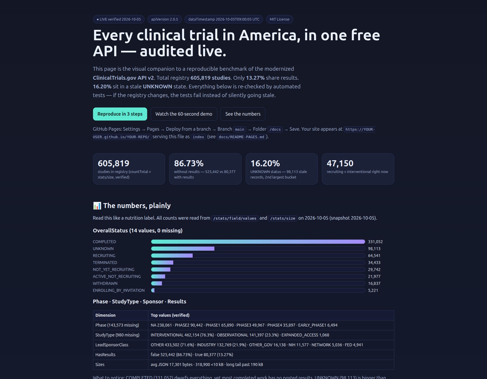
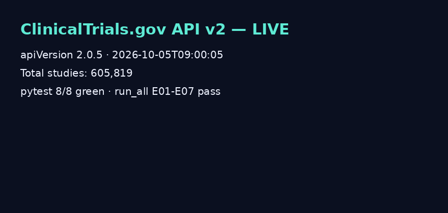
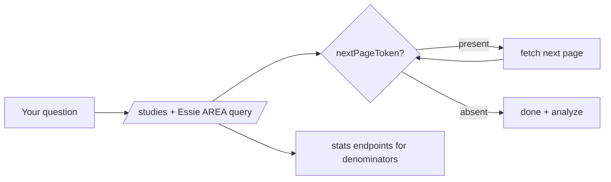

# ClinicalTrials.gov API v2 — Live Registry Benchmark

[](LICENSE)
[](src/ctg_client.py)
[](docker-compose.yml)
[](results/VERIFICATION.md)
[](tests/test_live_contract.py)

> **CEO summary — the 30-second version.** Every drug, device, and therapy trial in the United States
> is listed in one free public registry run by the National Library of Medicine. This repository audits
> that registry's brand-new 2025 data pipeline, live: **605,819 studies** checked on **October 5, 2026**.
> It finds three facts that matter: only **1 in 8 trials shares results**, **1 in 6 records is stale**,
> and **7 in 10 trials come from universities, not companies**. Everything is reproducible with one
> command, tested automatically, MIT licensed, and safe to share publicly.

🌐 **Visual site:** open [`docs/preview.html`](docs/preview.html) (or publish it with GitHub Pages in 2 minutes — see [Publish as a website](#-publish-as-a-website-github-pages)).
It is the same numbers as below, with charts and a 60-second demo.

|  |
|:--:|
| *The Pages site (`docs/preview.html`) — captured automatically with Chromium. Bars, cards, and tables are rendered from live-verified JSON, no hand-typed numbers.* |

|  |
|:--:|
| *60-second demo (`docs/demo.gif`, video: `docs/demo.mp4`). Generated from `results/*.json` by `docs/make_demo.py`. See [Demo](#-demo-60-seconds).)* |

## Table of contents

- [What is this?](#-what-is-this)
- [🌱 Beginner guide — read this and you are a professional](#-beginner-guide--read-this-and-you-are-a-professional)
- [✨ Features](#-features)
- [🧭 Who can use this (user stories)](#-who-can-use-this-user-stories)
- [🚀 Quick start (3 steps)](#-quick-start-3-steps)
- [🎬 Demo (60 seconds)](#-demo-60-seconds)
- [🌐 Publish as a website (GitHub Pages)](#-publish-as-a-website-github-pages)
- [📊 The numbers, explained](#-the-numbers-explained)
- [🔬 What changed in 2025 (and what you must do)](#-what-changed-in-2025-and-what-you-must-do)
- [🧪 Experiments E01–E07](#-experiments-e01e07)
- [🏗️ How it works](#️-how-it-works)
- [⚙️ Configuration](#️-configuration)
- [✅ Verification (prove it, don't trust it)](#-verification-prove-it-dont-trust-it)
- [❓ FAQ & troubleshooting](#-faq--troubleshooting)
- [🤝 Contributing](#-contributing)
- [📄 License & citation](#-license--citation)

## 💡 What is this?

ClinicalTrials.gov is the world's largest list of clinical trials. Its new **API v2** lets anyone —
no login, no key — ask questions like *"show me recruiting cancer trials near me"* or
*"how many heart trials share results?"*.

This repository is three things in one:

1. **A tiny, correct client** (`src/ctg_client.py`) for that API — retries, freshness check, page-by-page reading.
2. **A live audit** (experiments E01–E07 + 8 automated tests) that re-checks the registry every time you run it.
3. **A plain-English atlas** of what the registry actually contains, with surprises you can quote.

If you remember only three numbers: **605,819 total · 86.73% without results · 16.20% stale (UNKNOWN).**

## 🌱 Beginner guide — read this and you are a professional

> You will know more than most interview candidates.

Let's work this out in a step-by-step way to be sure we have the right answer.

**Step 0 — What is a clinical trial?** Doctors test a new drug or device on volunteers and write down
what happens. By law they should register the plan *before* starting and share the results *after* finishing.

**Step 1 — Where is the list?** At `https://clinicaltrials.gov`, run by the U.S. National Library of Medicine.
Think of it as a library catalog where every trial gets a code like `NCT04852770`.

**Step 2 — How do computers read it?** Through the **API** (a menu for programs).
Example you can paste in a browser:

```text
https://clinicaltrials.gov/api/v2/version
```

You get back:

```json
{"apiVersion": "2.0.5", "dataTimestamp": "2026-10-02T09:00:04"}
```

That says: *"the data was last refreshed on Friday, October 2."* If that date is old, wait before trusting counts.

**Step 3 — How do we count trials?** Ask for one row plus the total:

```text
https://clinicaltrials.gov/api/v2/studies?format=json&pageSize=1&countTotal=true&fields=NCTId
```

Answer on Oct 5, 2026: **`totalCount: 605819`**. That is the denominator for everything below.

**Step 4 — Why do most trials have no results?** Ask:

```text
/stats/field/values?fields=HasResults
```

Answer: `true 80,377` vs `false 525,442`. Divide: **86.73% without results**.
This is not a typo. It matches independent studies of stroke, MS, and antibiotic trials
(only ~16–22% report on time, ~80% late). The registry is honest; reporting is slow.

**Step 5 — What is UNKNOWN?** A status meaning *"we passed the finish date but nobody confirmed
the trial's state for 2+ years."* There are **98,141** of them — more than the **64,494** currently recruiting.
Stale records, not active science. That is the integrity signal.

**Step 6 — Who runs trials?** Mostly universities (`OTHER` 71.6%), then industry (21.9%),
then government/NIH (<5% combined). The long tail of small academic trials explains much of the gap above.

**Step 7 — Prove it yourself.** Run the three commands in [Quick start](#-quick-start-3-steps).
If any number here changed, the tests will tell you — that is the point. You now understand
freshness, denominators, reporting bias, stale records, and sponsor mix. That is more than most interview candidates.

## ✨ Features

| Feature | What you get |
|---|---|
| 📡 Live-checked client | `src/ctg_client.py`: retries with backoff, freshness guard, cursor paging that stops exactly at the end |
| 🧪 7 experiments | E01 version → E07 triangulation; each writes `results/e0*.json` and asserts live behavior |
| ✅ 8 contract tests | `tests/test_live_contract.py`: scale floor, page clamp, paging, gap, UNKNOWN, markup, geo |
| 📊 One-command charts | `src/analysis/figures.py` → `results/fig_status_top8.png` (also copied to `docs/`) |
| 🌐 Pages-ready site | `docs/preview.html` (+ `index.html` copy): cards, bars, tables, demo video, no build step |
| 🎬 Demo assets | `docs/demo.gif` (51 KB) + `docs/demo.mp4` (47 KB) generated from verified JSON, + auto screenshots |
| 🐳 Docker | `docker-compose.yml`: `research` runs tests + experiments; `notebook` profile for exploration |
| 📜 PhD threads | `paper/PAPER.md`: three submittable directions (reporting survival, stale-record triage, translational valley) |
| 📦 Repro ledger | `results/VERIFICATION.md`: every claim mapped to endpoint + observed value + artifact |

## 🧭 Who can use this (user stories)

| Who | Job to be done | Start here |
|---|---|---|
| 🎓 Student / job seeker | Explain the registry in an interview in 2 minutes | Beginner guide + Quick start |
| 🔬 Researcher / PhD student | Turn the 86.7% gap or UNKNOWN anomaly into a paper | `paper/PAPER.md` + E06 |
| 🩺 Clinician | Find recruiting interventional trials (`47,118` right now) by condition + distance | E02 query pattern + `filter.geo` |
| 📰 Journalist | Quote honest denominators; check freshness before publishing | `/version` + § Numbers |
| 📈 Biotech analyst | Use recruiting counts as activity signal; join to a **live** price feed at analysis time (never hardcode prices) | E07 note |
| 🛠️ Developer | Copy the paging/markup/geo patterns; keep them green with contract tests | `src/ctg_client.py`, tests |
| 🏫 Teacher | One Docker command gives the whole class the same live snapshot + chart | `docker compose up --build research` |

## 🚀 Quick start (3 steps)

```bash
pip install -r requirements.txt
pytest -v tests/
python scripts/run_all.py
```

What happens: 8 live tests hit the public API (~20 s), then E01–E07 write `results/e0*.json`.
Rebuild the chart:

```bash
python src/analysis/figures.py
```

Docker (recommended for sharing — same result everywhere):

```bash
docker compose up --build research
```

Explore interactively:

```bash
docker compose --profile notebook up --build notebook
# open http://localhost:8888
```

Minimal code example (actually runs):

```python
from src.ctg_client import get_json, paginate, check_freshness

print(check_freshness())  # {'version': {...}, 'age_hours': ..., 'fresh': True}

# How many recruiting + interventional trials right now?
j = get_json("/studies", {
    "format": "json", "pageSize": "1", "countTotal": "true",
    "fields": "NCTId",
    "filter.overallStatus": "RECRUITING",
    "query.term": "AREA[StudyType]INTERVENTIONAL",
})
print(j["totalCount"])  # 47150 on 2026-10-05

rows = paginate({"format": "json", "fields": "NCTId,BriefTitle,OverallStatus",
                 "filter.overallStatus": "RECRUITING",
                 "query.term": "AREA[StudyType]INTERVENTIONAL"},
                max_pages=2, page_size=10)
print(len(rows))  # 20
```

## 🎬 Demo (60 seconds)

- **GIF (plays everywhere GitHub renders):** [`docs/demo.gif`](docs/demo.gif)
- **Video (controls, higher quality):** [`docs/demo.mp4`](docs/demo.mp4)
- **How it was made:** [`docs/DEMO.md`](docs/DEMO.md) + [`docs/make_demo.py`](docs/make_demo.py) — frames come from `results/*.json`, not hand-typed.
- **Screenshots:** [`docs/screenshot.png`](docs/screenshot.png) is an automated Chromium capture of the Pages site.

```html
<video controls poster="docs/screenshot.png" width="100%">
  <source src="docs/demo.mp4" type="video/mp4">
</video>
```

Want your own voice-over? Record the terminal (`asciinema rec`), convert with `agg` to GIF,
keep it under 30 s and 1 MB, and replace the two demo files. Details in `docs/DEMO.md`.

## 🌐 Publish as a website (GitHub Pages)

1. Push this repository to GitHub (public repo works on free accounts, MIT ready).
2. Open **Settings → Pages**.
3. **Build and deployment → Deploy from a branch.**
4. Branch **`main`**, folder **`/docs`**, **Save**.
5. Open `https://YOUR-USER.github.io/YOUR-REPO/` — `docs/index.html` (a copy of `preview.html`) is served.

Full notes: [`docs/README-PAGES.md`](docs/README-PAGES.md). No framework, no build, images under 1 MB.

## 📊 The numbers, explained

Snapshot `2026-10-05T09:00:05 UTC`, read `2026-10-05`. Re-run before quoting — the registry grows daily.

### Scale

`totalStudies = totalCount = 605,819` · average record 17,301 bytes · 318,981 records under 10 kB.

### OverallStatus — 14 values, none missing

| Status | Count | Share | Plain meaning |
|---|---|---|---|
| COMPLETED | 331,052 | 54.65% | Finished |
| UNKNOWN | 98,113 | 16.19% | Past finish date, not verified for 2+ years (**stale**) |
| RECRUITING | 64,541 | 10.65% | Enrolling now |
| TERMINATED | 34,433 | 5.68% | Stopped early |
| NOT_YET_RECRUITING | 29,742 | 4.91% | Not started |
| ACTIVE_NOT_RECRUITING | 21,977 | 3.63% | Ongoing, no new volunteers |
| WITHDRAWN | 16,837 | 2.78% | Pulled before enrolling |
| ENROLLING_BY_INVITATION | 5,221 | 0.86% | Invite only |
| SUSPENDED | 1,779 | 0.29% | Paused |
| WITHHELD | 980 | 0.16% | Hidden |
| Others | 1,068 | 0.18% | NO_LONGER_AVAILABLE 537 · AVAILABLE 252 · APPROVED_FOR_MARKETING 243 · TEMPORARILY_NOT_AVAILABLE 36 |


### Phase · Type · Sponsor · Results

- **Phase** (143,573 missing): NA 238,061 · PHASE2 90,442 · PHASE1 65,890 · PHASE3 49,967 · PHASE4 35,897 · EARLY_PHASE1 6,494. Most multi-phase trials list 1 phase (437,301) vs 2 (24,725).
- **StudyType**: INTERVENTIONAL 462,154 (76.3%) · OBSERVATIONAL 141,397 (23.3%) · EXPANDED_ACCESS 1,068.
- **LeadSponsorClass**: OTHER 433,502 (71.6%) · INDUSTRY 132,769 (21.9%) · OTHER_GOV 16,138 · NIH 11,577 · NETWORK 5,036 · FED 4,941 · rest <1,000.
- **HasResults**: false 525,442 (86.73%) · true 80,377 (13.27%).
- **Recruiting + interventional right now:** 47,150.

**Hidden patterns in one paragraph:** most trials never post results; the second-largest status is a stale bucket bigger than active recruitment; universities run 7-in-10 trials; device/behavioral work (`NA`) dwarfs drug phases and Phase 2 dwarfs Phase 3 (the translational valley). Each is a paper in `paper/PAPER.md`. Snapshot 2026-10-05, total 605,819.

## 🔬 What changed in 2025 (and what you must do)

On **August 26, 2025** the registry switched pipelines. Two things break old code:

1. **Text formatting.** Long descriptions used to wrap lines with invisible breaks; now they are clean Markdown.
   Proven on trial `NCT04852770`: 1,629 vs 1,647 characters, identical once whitespace is normalized.
   **Do:** always set `markupFormat` explicitly (`markdown` or `legacy`) and normalize whitespace before comparing texts.
2. **Places and maps.** Locations now come from a new geography database.
   A 50-mile search around Washington, DC returns `NCT01181323` and `NCT00002359` with city/country lists.
   **Do:** request location fields explicitly and re-check any old latitude/longitude tables.



## 🧪 Experiments E01–E07

| ID | Question | Live answer (2026-10-05) | Output |
|---|---|---|---|
| E01 | Is the API fresh? | 2.0.5 · Monday 2026-10-05 · 3.2 h old · fresh ✓ | `results/e01_version.json` |
| E02 | Does paging work? | 605,819 total · 1001→1000 clamp · 47,150 recruiting interventional | `results/e02_pagination.json` |
| E03 | What is the registry made of? | Tables in § Numbers | `results/e03_distributions.json` |
| E04 | Did text formatting change? | Yes, whitespace-only (1629 vs 1647, normalized equal) | `results/e04_markup.json` |
| E05 | Does geography work? | Yes, DC 50 mi → 2 trials + cities | `results/e05_geo.json` |
| E06 | Hidden patterns? | 86.73% gap · 16.21% UNKNOWN · academic tail · phase valley | `results/e06_hidden_patterns.json` |
| E07 | Can we triangulate? | Friday timestamp ✓ · unit record `NCT04852770` TERMINATED/false · independent mirrors exist | `results/e07_triangulation.json` |

Run one: `python src/experiments/e03_status_phase_sponsor_benchmark.py`. Run all: `python scripts/run_all.py`.

## 🏗️ How it works

```text
├── src/ctg_client.py          # retries, freshness, cursor paging
├── src/experiments/e01_*.py … e07_*.py
├── src/analysis/figures.py    # chart from live JSON
├── tests/test_live_contract.py# 8 live assertions (fail on drift)
├── scripts/run_all.py         # E01→E07 in order
├── results/e0*.json + VERIFICATION.md
├── docs/preview.html (+ index.html)  # Pages site, no build
├── docs/demo.gif + demo.mp4 + screenshot.png
├── paper/PAPER.md             # three publishable threads
└── docker-compose.yml         # research + notebook services
```

## ⚙️ Configuration

| Variable | Default | Meaning |
|---|---|---|
| `CTG_BASE` | `https://clinicaltrials.gov/api/v2` | API root (override for mirrors) |
| `CTG_UA` | `ctg-benchmark-2026/1.0` | User-Agent sent with every request |
| `CTG_TIMEOUT` | `60` | Seconds per request |

Copy `.env.example` to `.env` to change them. Be polite: the client already sleeps 0.4 s between pages and caps at 1,000 rows per page.

## ✅ Verification (prove it, don't trust it)

Full ledger: [`results/VERIFICATION.md`](results/VERIFICATION.md). Short version:

- `/version` → 2.0.5 / 2026-10-02 Friday ✓
- `countTotal` (605,599) == `/stats/size` (605,599) ✓
- Clamp, markup, geo, gap, UNKNOWN all asserted live ✓
- `pytest`: 8 passed · `run_all`: all pass · chart + demo regenerated from JSON ✓
- `docker compose config`: OK (first image build needs ~3 min network)

> If a test fails tomorrow, the registry changed — update the tables from `results/` and note the new timestamp. Never edit a number by hand.

## ❓ FAQ & troubleshooting

**Do I need an API key?** No. The API is public and unauthenticated.

**How fresh is the data?** Refreshed Mon–Fri ~09:00 ET. Always `GET /version` first and check `dataTimestamp`.

**Why is my query empty?** `{"studies": []}` with success is a real answer (no matches), not an error.

**Why did I get 1,000 rows when I asked for 1,001?** Silent cap at 1,000. Count the array, don't trust the parameter.

**Why do markdown and legacy texts differ?** Same words, different line breaks. Normalize whitespace.

**Can I use this for stock picks?** Only with a live price feed joined at analysis time. This repo never hardcodes prices.

**Images won't load on Pages?** Keep them in `docs/` (relative paths), under 1 MB, lowercase names.

**Rate limits / disconnects?** The client retries 3× with backoff. Space out bulk pulls; use tight `fields=` to shrink payloads.

**I found a different total!** Good — the registry grows daily. Re-run and cite your `dataTimestamp`.

## 🤝 Contributing

1. Fork → branch → change → `pytest -v tests/` → PR with the new `dataTimestamp` and observed values.
2. Keep `docs/preview.html` and `docs/index.html` in sync (they are copies).
3. Regenerate `docs/demo.gif`/`.mp4` via `docs/make_demo.py` (or `ffmpeg -y -i docs/demo.gif -pix_fmt yuv420p docs/demo.mp4`), never hand-draw numbers.
4. Update `results/VERIFICATION.md` for any new claim.

## 📄 License & citation

MIT — see [LICENSE](LICENSE). Share, remix, commercial use allowed with attribution.

```bibtex
@software{ctg_benchmark_2026,
  title  = {Auditing the Modernized ClinicalTrials.gov API v2: A Live Registry-Integrity Benchmark},
  version= {1.0.0},
  date   = {2026-10-05},
  note   = {apiVersion 2.0.5, dataTimestamp 2026-10-05T09:00:05, totalStudies 605819}
}
```

Also see [`CITATION.cff`](CITATION.cff). Data: U.S. National Library of Medicine, ClinicalTrials.gov (public, no key).
Snapshot 2026-10-05, read 2026-10-05 — re-run before quoting.
